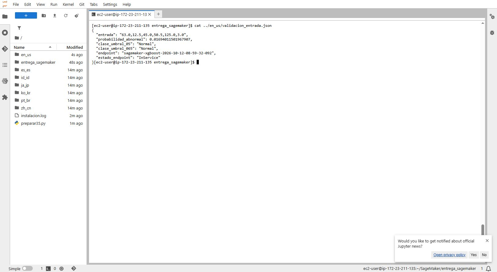

# Entrenamiento y despliegue en Amazon SageMaker

**Estudiante:** Santiago Perez Garzon · **Curso:** AWS Academy Machine Learning Foundations  
**Laboratorios:** 3.4 y 3.5 · **Región:** `us-east-1`

**Repositorio:** https://github.com/Santiago0312/aws-sagemaker-eda-laboratorios  
**Rama:** `actividad-entrenamiento-despliegue`

Esta rama se eligió porque el enunciado recibido no indica un nombre específico. Si el docente exige otro, debe ajustarse antes de entregar. La actividad anterior está en [README_EDA.md](README_EDA.md).

## Pasos y propósito

1. **Acceso.** Ingresé a cada laboratorio desde AWS Academy, comprobé `MyNotebook` en estado `InService` y abrí JupyterLab. Utilicé el rol y el bucket suministrados por cada sesión.
2. **Preparación.** Descargué Vertebral Column de UCI mediante HTTPS y cargué `column_2C_weka.arff`: 310 registros, seis variables numéricas y una etiqueta. Codifiqué `Abnormal=1`, `Normal=0` y coloqué la etiqueta primero para cumplir el formato de XGBoost.
3. **División y S3.** Separé 248 filas de entrenamiento, 31 de validación y 31 de prueba. La estratificación conserva la proporción de clases y la semilla 42 permite repetir la división. Subí los CSV sin encabezado ni índice a prefijos separados. Reservé prueba para evaluar generalización.
4. **Entrenamiento 3.4.** Usé XGBoost `1.0-1`, 42 rondas, `binary:logistic` y AUC. El objetivo produce una puntuación para la clase positiva; AUC evalúa la separación entre clases. SageMaker guarda el artefacto en S3. Adapté `ModelTrainer.train` a `Estimator.fit` porque la instancia trae SDK 2, conservando la configuración oficial. El resultado real se registra en `resultados/resultado_lab34.json`.
5. **Despliegue 3.5.** Ejecuté el entrenamiento de preparación incluido en su notebook independiente y desplegué una instancia `ml.m4.xlarge` con `CSVSerializer`. Confirmé el endpoint `InService` y envié la entrada del profesor.
6. **Lotes, evaluación y limpieza.** Envié las 31 filas de prueba sin etiqueta a Batch Transform, con `MultiRecord` y separación por líneas. El trabajo terminó `Completed`. Comparé las probabilidades con las etiquetas y calculé las métricas. Después de guardar evidencias, eliminé el endpoint y su configuración; el waiter de AWS confirmó la eliminación en `resultados/limpieza_lab35.json`.

## Entrada solicitada y lectura del resultado

```python
entrada = "63.0,12.5,45.0,50.5,125.0,3.0"
respuesta = xgb_predictor.predict([float(v) for v in entrada.split(",")])
```

Orden: `pelvic_incidence`, `pelvic_tilt`, `lumbar_lordosis_angle`, `sacral_slope`, `pelvic_radius`, `degree_spondylolisthesis`.

**Respuesta real: `0.01694011501967907`.** Corresponde aproximadamente al 1,69 % para `Abnormal=1`. La clasificación es **Normal (0)** con umbrales 0,5 y 0,65. Es una estimación del modelo sobre este conjunto; no representa certeza clínica.



## Métricas sobre prueba

Se evaluaron 31 casos: 10 normales y 21 anormales. La clase positiva es Abnormal. El umbral 0,65 reproduce la guía y 0,5 permite comparar.

| Métrica | Umbral 0,5 | Umbral 0,65 |
|---|---:|---:|
| Exactitud | 83,87 % | 80,65 % |
| Precisión | 86,36 % | 85,71 % |
| Recall | 90,48 % | 85,71 % |
| F1 | 88,37 % | 85,71 % |
| ROC AUC | 0,8905 | 0,8905 |
| Verdaderos negativos | 7 | 7 |
| Falsos positivos | 3 | 3 |
| Falsos negativos | 2 | 3 |
| Verdaderos positivos | 19 | 18 |

Exactitud mide aciertos totales; precisión, cuántas predicciones positivas fueron correctas; recall, cuántos positivos se detectaron; F1 combina precisión y recall. AUC usa las probabilidades y no depende del umbral. El entrenamiento de 3.5 obtuvo AUC 1,0000 en entrenamiento y 0,9667 en validación. Los valores completos están en [resultado_lab35.json](resultados/resultado_lab35.json).

## Reflexión

El modelo supera la referencia de predecir siempre Abnormal, que acertaría 21/31 casos (67,74 %). Con umbral 0,5 quedan tres falsos positivos y dos falsos negativos. Subir a 0,65 añade un falso negativo sin reducir los falsos positivos en esta muestra. El umbral debe elegirse considerando el costo de ambos errores y validarse en más datos.

La diferencia entre AUC de entrenamiento, validación y prueba sugiere estudiar sobreajuste. Solo 31 casos de prueba limitan la estabilidad de la estimación. Propongo validación cruzada estratificada, ajuste de profundidad y regularización, comparación con modelos sencillos y evaluación en datos representativos del uso real. En la nube también se deben controlar costos, mantener el orden de variables y monitorear cambios en los datos.

## Evidencias y repositorio

- [Notebook 3.4 ejecutado](notebooks/3_4_entrenamiento_santiago.ipynb).
- [Notebook 3.5: 39 celdas y cero errores](notebooks/3_5_despliegue_santiago.ipynb).
- [Entrenamiento 3.5 Completed](evidencias/actividad_entrenamiento_despliegue/04_lab35_entrenamiento_completed.jpg).
- [Endpoint InService](evidencias/actividad_entrenamiento_despliegue/06_lab35_endpoint_inservice.jpg).
- [Batch Transform Completed](evidencias/actividad_entrenamiento_despliegue/07_lab35_batch_completed.jpg).
- [Métricas reales de prueba](evidencias/actividad_entrenamiento_despliegue/08_lab35_metricas_prueba.jpg).
- [Instancia activa 3.4](evidencias/actividad_entrenamiento_despliegue/09_lab34_instancia_actual.jpg).

Los commits se hicieron en las terminales de los workspaces de SageMaker. Los bundles descargados conservan ese historial para publicar la rama desde el equipo local. Los nombres de los trabajos relacionan las capturas con los resultados.

## Uso ético de IA

Se utilizó IA para revisar compatibilidad del código, organizar evidencias y redactar explicaciones. Las probabilidades, métricas y capturas proceden de ejecuciones reales de AWS. El estudiante conserva la responsabilidad de revisar, comprender y sustentar la entrega.
